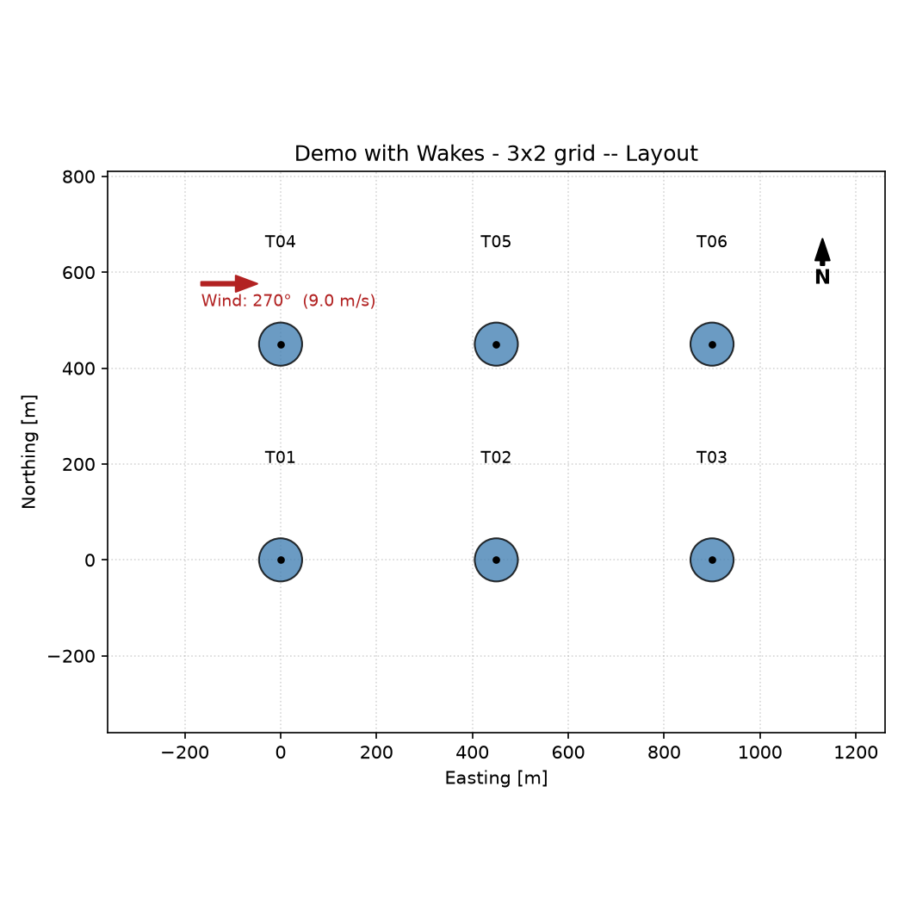

# Wind Farm Energy Assessment

**Case study with figures: [zaydhouachmi.github.io/work/wind-farm.html](https://zaydhouachmi.github.io/work/wind-farm.html)** · [Try the wake model in your browser](https://zaydhouachmi.github.io/#model)

A Streamlit application that estimates the annual energy production of a wind
farm from wind measurements, terrain roughness and a turbine layout. Built
during an internship at Greenard as a lightweight, open alternative to
commercial tools such as WAsP.



## What it does

1. **Wind resource** — builds a wind rose from a dominant direction, a manual
   12-sector table, or an uploaded CSV (either sector statistics or raw
   measurements, with Weibull parameters fitted by the method of moments).
2. **Vertical extrapolation** — scales wind speed to hub height using the
   logarithmic profile and the site roughness length `z0`.
3. **Wake modelling** — computes velocity deficits between turbines (Jensen
   and Ainslie-derived models) so downstream turbines see the reduced wind.
4. **Energy yield** — integrates the power curve over the wind distribution,
   then applies a cascade of six loss factors (shadow flicker, flow effect,
   availability, electrical, turbine performance, environmental).
5. **Results** — gross / after-wake / net energy, capacity factor, and total
   wake loss, with layout and wind rose plots.

## Results

Fed the 12-sector Weibull table from the WAsP "Waspdale" example site, the tool recomputes a **4.90 m/s** mean wind speed, the same value WAsP reports. A 6-turbine, 1 MW farm (54 m rotor, 50 m hub, 5 rotor diameters apart, Jensen wakes) then shows why height and terrain correction matter:

| Wind climate | Mean speed | Gross energy | Net energy | Capacity factor |
|---|---|---|---|---|
| Raw station data (10 m) | 4.90 m/s | 3,679 MWh/yr | 2,663 MWh/yr | 5.1 % |
| Corrected to the turbine site (50 m) | 7.88 m/s | 16,186 MWh/yr | 9,264 MWh/yr | 17.6 % |

The second row puts all the wind in one direction (270°), which is the worst case for wakes: up to 62 % loss on the third turbine in a row. A real wind rose spreads the wakes out. `tests/test_model.py` checks that behaviour.

## Getting started

```bash
pip install -r requirements.txt
streamlit run app.py
```

Then open the URL Streamlit prints (usually <http://localhost:8501>).

## Input file formats

Example CSVs are included so you can see the expected columns:

| File | Columns |
|---|---|
| `wind_rose_example.csv` | `direction_deg, frequency_pct, weibull_k, weibull_a` |
| `wind_measurements_example.csv` | `direction_deg, speed_ms` (one row per reading) |
| `power_curve_example.csv` | `wind_speed_ms, power_kw` |
| `layout_example.csv` | `id, x, y` (metres) |
| `roughness_example.csv` | `z0` |

## Project layout

| Module | Role |
|---|---|
| `app.py` | Streamlit interface — all inputs and results |
| `wind_resource.py` | Wind rose, Weibull fitting, vertical extrapolation |
| `power_curve.py` | Parametric and tabulated turbine power curves |
| `wake_model.py` | Wake deficit models |
| `energy_yield.py` | Gross/net energy and the six-factor loss cascade |
| `turbine.py`, `wind_farm.py` | Turbine and farm data structures |
| `topography.py` | Terrain roughness handling |
| `visualization.py` | Layout and wind rose plots |
| `demo_*.py` | Runnable examples that produce the images above |
| `tests/` | pytest suite for the model |

`PHASE_2_AINSLIE_DERIVATION.md` documents the maths behind the wake model, and
`CHANGELOG-v3.md` records what changed between versions (in French).

## Tests

```bash
pip install pytest
python -m pytest
```

22 tests in `tests/test_model.py` check the model against hand calculations: the Jensen wake formula, the power curve, Weibull statistics, log-law height scaling, the loss cascade, wind-aligned geometry, and the farm energy table. `demo_smoke.py` is a quick script that compares the three wake models on one layout.

## Known limitations

- No orographic correction for terrain relief — only roughness and height are
  accounted for.
- The thrust coefficient `Ct` is fixed (0.8 by default) rather than varying
  with wind speed.
- Weibull fitting from raw measurements uses the Justus method of moments, not
  maximum likelihood — good enough for estimation, less precise than a
  dedicated tool.
